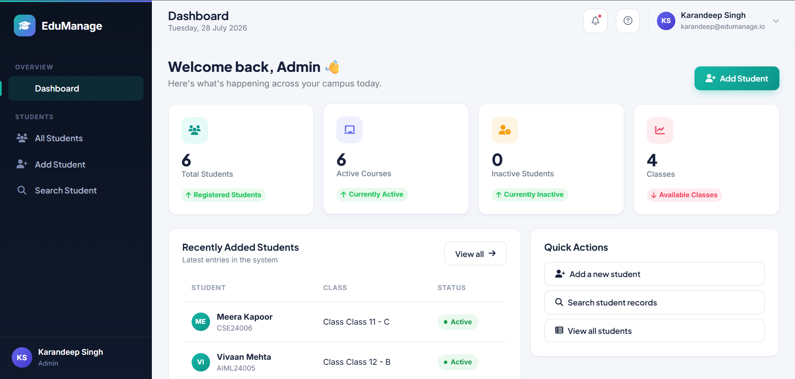
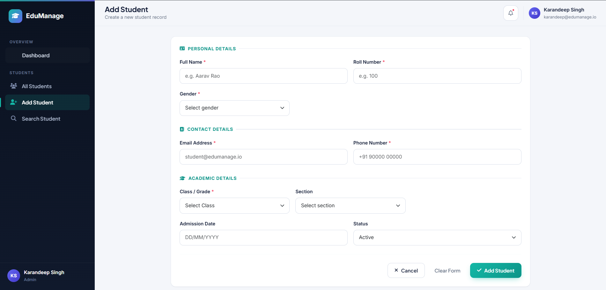
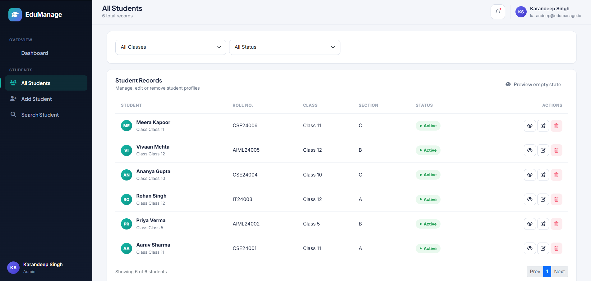
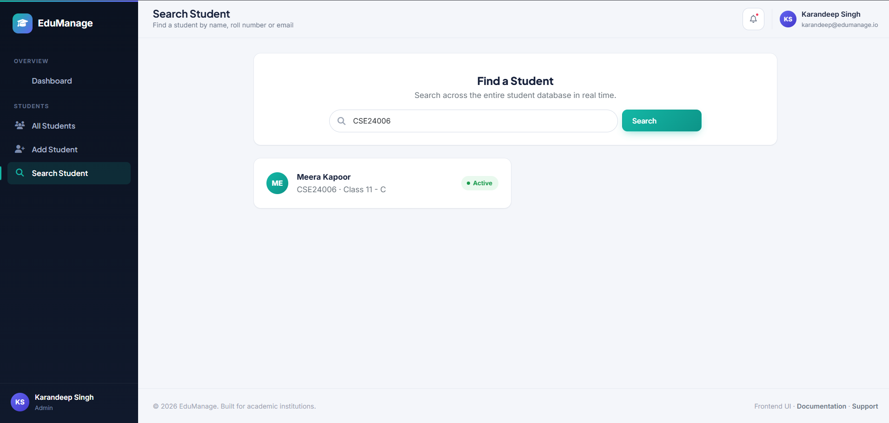
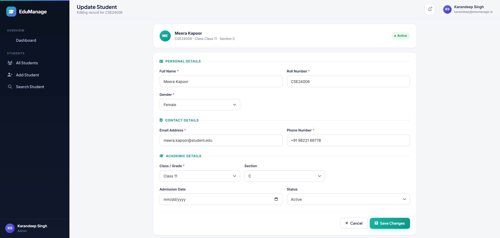
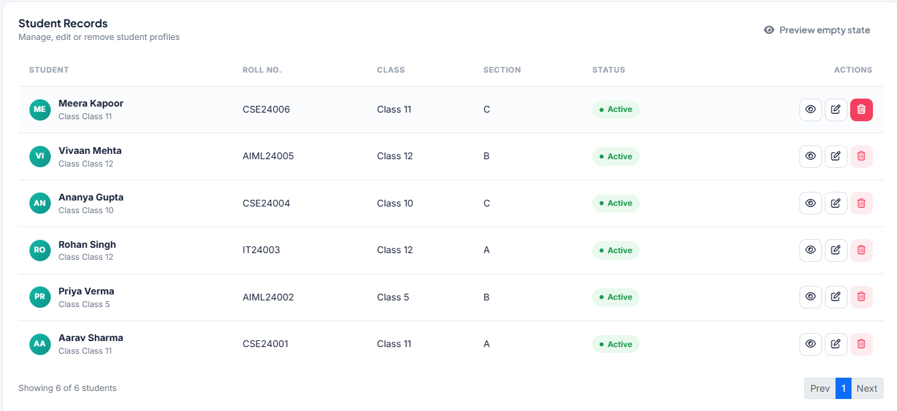

# 🎓 EduManage – Student Management System

A modern full-stack Student Management System built using **FastAPI**, **MongoDB Atlas**, **Jinja2**, **HTML**, **CSS**, and **JavaScript**. The application provides a responsive dashboard, complete CRUD functionality, advanced search, and server-side pagination for efficient student record management.


## 📖 Overview

The **Student Management System** is a full-stack web application developed using **FastAPI**, **MongoDB Atlas**, **Jinja2**, and **Bootstrap 5**. It enables administrators to efficiently manage student records through complete CRUD (Create, Read, Update, Delete) operations within a clean, responsive, and user-friendly interface.

The application includes a real-time dashboard with live student statistics, advanced multi-field search using MongoDB Regex, server-side pagination for improved performance, and seamless MongoDB Atlas integration. It demonstrates modern backend development concepts including FastAPI routing, dynamic template rendering, MongoDB CRUD operations, ObjectId handling, and responsive web design.

---

## 🚀 Key Highlights

- ⚡ Built using **FastAPI** with server-side rendering using **Jinja2**
- ☁️ Cloud database integration with **MongoDB Atlas**
- 📊 Interactive dashboard displaying real-time student statistics
- 🔍 Advanced multi-field search using **MongoDB Regular Expressions (Regex)**
- 📄 Server-side pagination for improved performance with large datasets
- ✏️ Complete CRUD operations (Create, Read, Update, Delete)
- 📱 Fully responsive user interface built with Bootstrap 5
- 🗂️ Clean and structured project architecture for easy maintenance

---

## ✨ Features

### 📊 Dashboard
- Displays real-time student statistics.
- Shows total students and provides quick navigation to all major modules.

### ➕ Add Student
- Register new students with essential information.
- Validates user input before storing records in MongoDB Atlas.

### 👀 View Students
- Displays student records in a clean, responsive table.
- Supports server-side pagination for better performance with large datasets.

### 🔍 Search Students
- Search students by **Name**, **Roll Number**, **Email**, or **Class**.
- Uses MongoDB Regular Expressions (Regex) for flexible and case-insensitive searching.

### ✏️ Update Student
- Modify existing student information.
- Changes are reflected instantly in the MongoDB database.

### 🗑️ Delete Student
- Remove student records securely from the database.
- Helps maintain accurate and up-to-date student information.

### ☁️ MongoDB Atlas Integration
- Stores all student records in a cloud-hosted MongoDB Atlas database.
- Provides reliable and scalable data storage.

### 📱 Responsive User Interface
- Built using HTML, CSS, Bootstrap 5, and Jinja2.
- Optimized for desktops, tablets, and mobile devices.


---

## 🛠️ Tech Stack

### Backend
- Python
- FastAPI
- Pydantic
- Uvicorn

### Frontend
- HTML5
- CSS3
- Bootstrap 5
- JavaScript
- Jinja2 Templates

### Database
- MongoDB Atlas
- PyMongo

### Development Tools
- Visual Studio Code
- Git
- GitHub


---

## 📂 Project Structure

```text
student-management-system/
│
├── static/
│   ├── css/
│   ├── js/
│   └── images/
│
├── templates/
│   ├── index.html
│   ├── add_student.html
│   ├── view_student.html
│   ├── search_student.html
│   ├── student_details.html
│   ├── update_student.html
│   └── delete_student.html
│
├── .env.example
├── .gitignore
├── README.md
├── requirements.txt
└── index.py
```

## 📸 Application Screenshots

### Dashboard



---

### Add Student



---

### View Students



---

### Search Students



---

### Update Student



---

### Delete Student




---

# ⚙️ Installation

## 1️⃣ Clone the Repository

```bash
git clone https://github.com/Karandeep2006/student-management-system.git
```

## 2️⃣ Navigate to the Project Directory

```bash
cd student-management-system
```

## 3️⃣ Install Required Dependencies

```bash
pip install -r requirements.txt
```


---

# 🔑 Environment Variables

Create a `.env` file in the project root and add the following:

```env
MONGO_URI=your_mongodb_connection_string
```

---

# ▶️ Running the Project

Start the FastAPI development server:

```bash
uvicorn index:app --reload
```

After the server starts, open your browser and visit:

```
http://127.0.0.1:8000
```


---

# 📈 Future Improvements

- 🔐 User Authentication & Authorization
- 📷 Student Profile Photo Upload
- 📤 Export Student Data to Excel/PDF
- 📊 Advanced Analytics Dashboard
- 📧 Email Notifications
- 🐳 Docker Support
- ☁️ Cloud Deployment


---

# 👨‍💻 Author

**Karandeep Singh**

- GitHub: https://github.com/Karandeep2006

If you found this project helpful, consider giving it a ⭐ on GitHub.